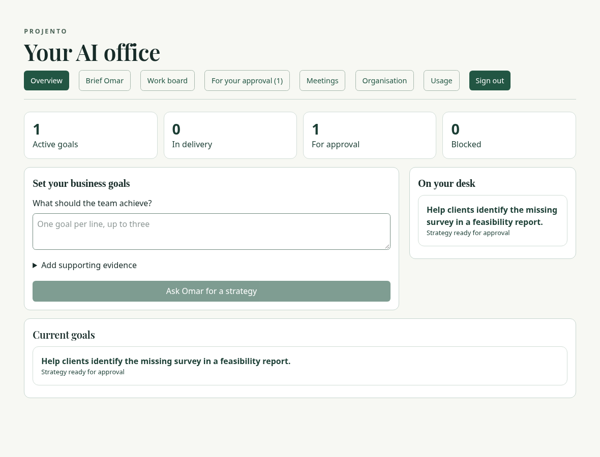
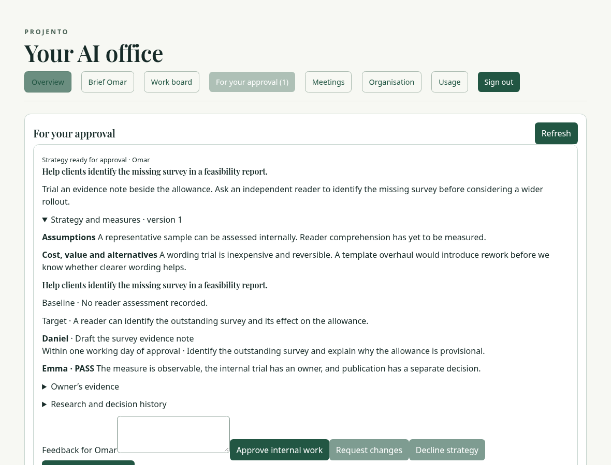
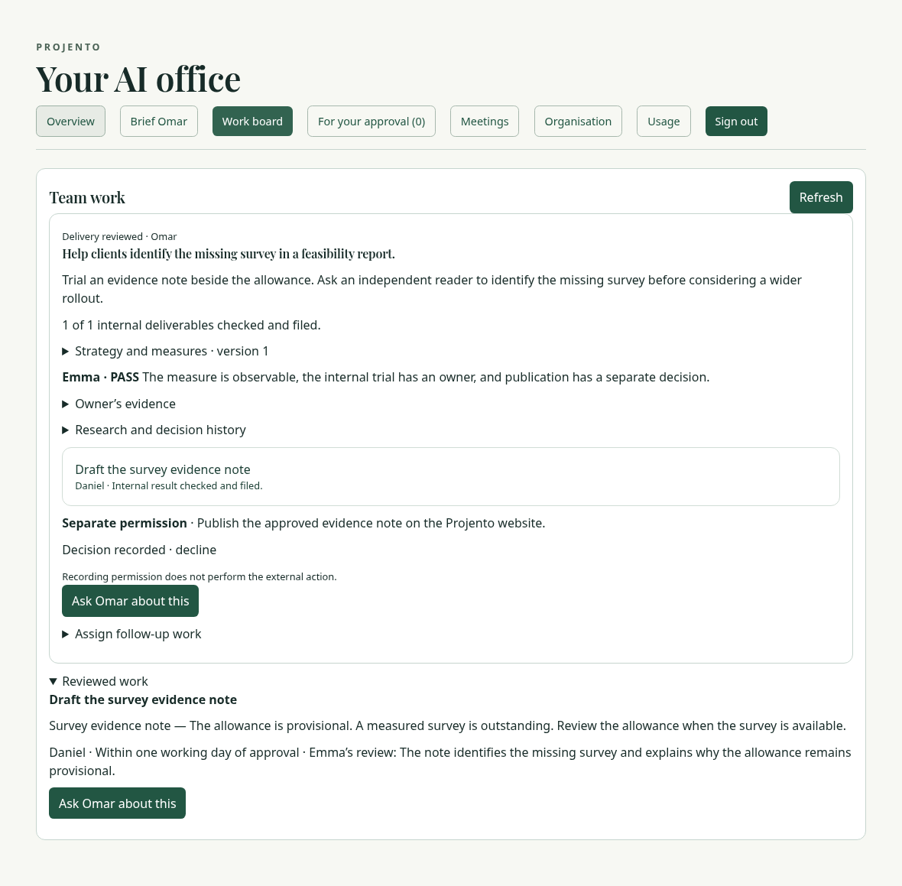
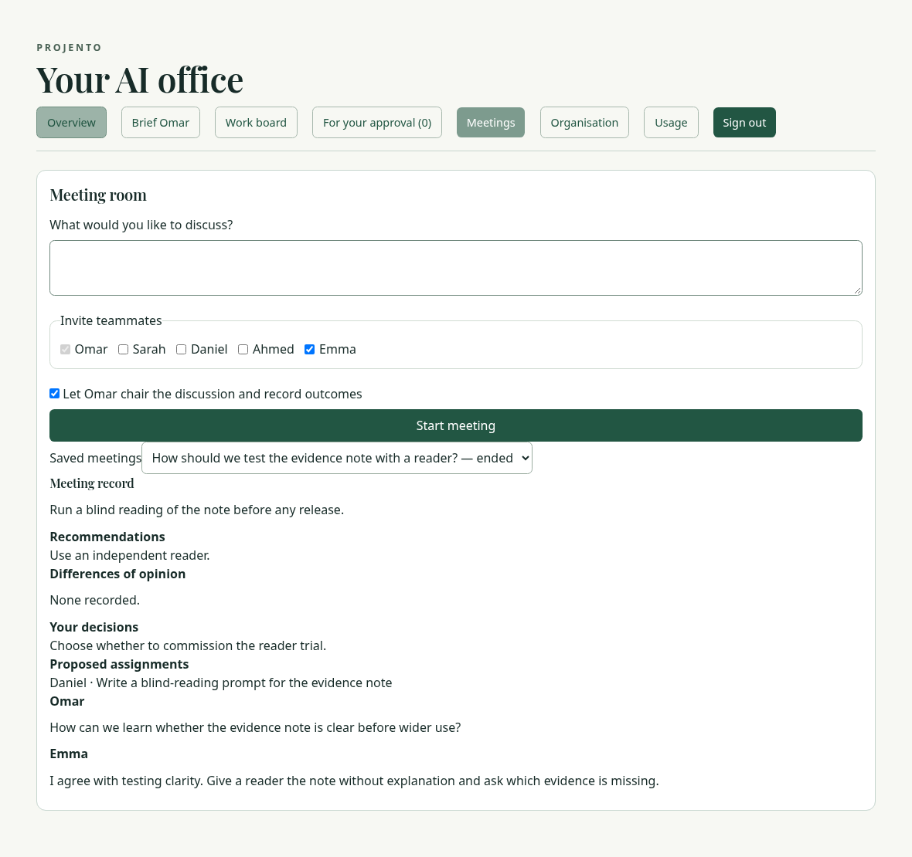

# Projento management office preview

This walkthrough follows a sample assignment through the redesigned office. The screens come from a signed-in browser using a test account, isolated storage and scripted model replies. The application saved the records, enforced the approval gates and measured the test usage. The quality of live AI advice still needs an owner trial.

## Give Omar an outcome

The business objective was to help clients identify a missing survey in a feasibility report. The owner supplied a sample observation and requested a strategy. The dashboard placed the reviewed proposal on the owner’s desk.

## Decide whether the strategy is worth pursuing

Omar consulted Daniel, proposed an internal wording trial, recorded that reader comprehension was unmeasured, and compared the trial with a more expensive template overhaul. Emma checked the exact version. At this point the register held the goal and **no delivery assignments**.

## Inspect what was delivered

Approving the strategy created Daniel’s assignment. He produced an evidence note identifying the outstanding survey. Emma checked that wording and Omar filed the internal result. The records survived a reload. A second approval request was refused. The test owner separately declined publication. Reader comprehension remains unmeasured.

## See what a meeting achieved

The owner invited Emma to discuss how to test the note. Omar chaired, Emma received his contribution before replying, and Omar received the discussion before recording the minutes. The proposed reading script entered the work register with a named specialist. The owner can ask Omar to plan it.

[View the mobile dashboard](mobile.png)

## Costs and limits

The office uses the configured Anthropic model. The repository default is Claude Haiku 4.5. Standard pricing for that model is US$1 per million input tokens and US$5 per million output tokens. The office records provider-reported token use and estimates the cost. Model processing time is separate from elapsed project time. [Anthropic pricing](https://platform.claude.com/docs/en/about-claude/pricing)

The existing daily fallback is 12 calls. An owner-set monthly budget replaces it and reserves the final 20% for conversation. The proposed additional defaults are US$1 and 18 calls for a strategy and its delivery combined, or for a meeting, with two automatic draft rounds. The owner can change these in Usage. Before a call, the office reserves a conservative allowance. A low balance can therefore pause work before the displayed spending reaches the limit. Failed attempts count towards the call limit. Unconfirmed charges retain their reservation.

## Checks and boundaries

- Tested the signed-out page, a different account, the owner’s second access check and persistence after reload.
- Tested an independent strategy revision, rejection, owner-requested changes, duplicate approval, specialist delivery, final review and a separate permission decision.
- Tested provider failure, a monthly allowance too small for the next reply, a per-strategy cost stop and free access to the saved briefing.
- Planning research uses the supplied evidence and approved office records. External publication, customer contact, purchases and changes to the live product require separate handling. Office agents have no connector that performs those actions.
- The test made no paid Anthropic calls. It does not establish live response quality, voice quality or actual business impact.
